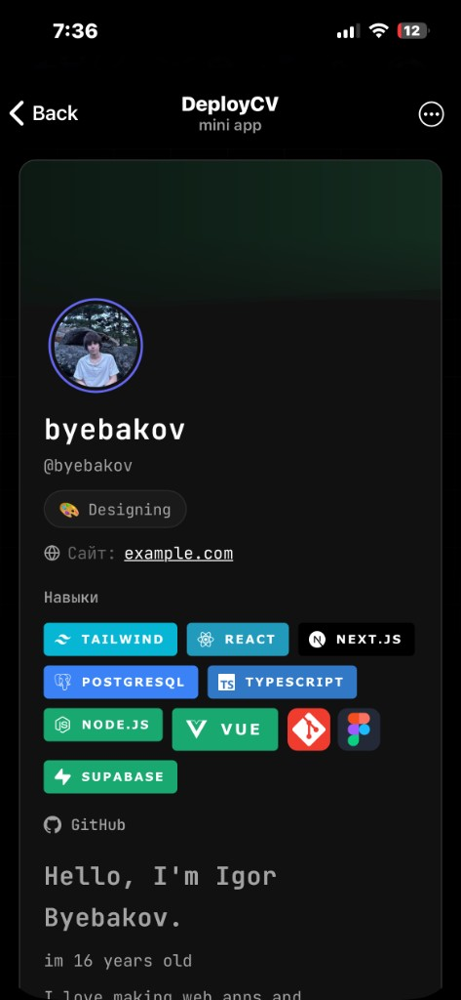
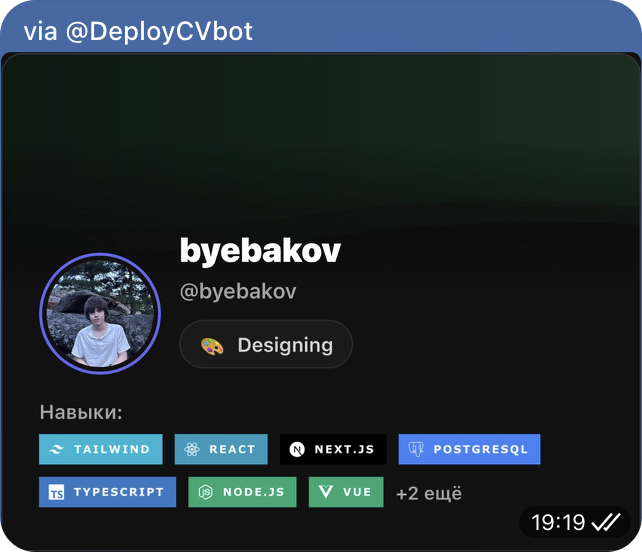

# Telegram Portfolio Mini App

## Examples

<p align="center">
  
  &nbsp;&nbsp;
  
</p>

<p align="center"><sub>Mini App profile · Inline share card</sub></p>

---

Open-source stack for a **Telegram Mini App + bot** that lets users build a shareable portfolio card and public profile page. Self-host the web app, database, edge API, and bot under your own bot name and domain.

**One line:** portfolio visit card in Telegram for freelancers — one link for clients, no separate website.

**Fresh deploy:** step-by-step checklist → [docs/DEPLOY_CHECKLIST.md](docs/DEPLOY_CHECKLIST.md).

---

## Architecture

```text
Telegram client
    ├─ Mini App (web/)          → Vercel / static host
    ├─ Bot webhook              → Vercel api/bot.js OR your TS/Python server
    └─ Inline share             → Bot API + prepared inline message

Supabase
    ├─ Postgres (migrations/)   → profiles, tech_stack, sections
    ├─ Storage                  → portfolio-images bucket
    └─ Edge Function            → portfolio-api (auth, upload, prepare-share)
```

---

## 1. Database (Supabase SQL)

### Create project

1. [supabase.com](https://supabase.com) → **New project**.
2. Note **Project URL**, **anon key**, **service role key** (server only).
3. **Storage** → create public bucket: `portfolio-images` (public read for portfolio assets).

### Run migrations (order matters)

In **SQL Editor**, run each file in `supabase/migrations/` **in numeric order**:

| File | Purpose |
|------|---------|
| `001_initial_schema.sql` | `profiles`, `tech_stack`, `portfolio_sections`, base RLS |
| `002_secure_rls.sql` | Tighten insert/update policies |
| `003_tech_badge_size.sql` | Badge size column |
| `003_share_card_url.sql` | Share card URL on profile |
| `005_tech_badge_url.sql` | Custom badge image URL |
| `007_hide_telegram_id_public.sql` | Public view without `telegram_id` |
| `008_security_hardening.sql` | `public_profiles` view, rate limits, revoke direct `profiles` read |
| `009_supporter_badge.sql` | Optional donor badge columns |

Or with CLI (replace `YOUR_PROJECT_REF`):

```bash
supabase link --project-ref YOUR_PROJECT_REF
supabase db push
```

### What you get

- **`profiles`** — user portfolio (theme JSON, social links, media URLs, `telegram_id` unique).
- **`tech_stack`**, **`portfolio_sections`** — skills and content blocks.
- **`public_profiles`** — safe read-only view for anonymous clients (no `telegram_id`).
- **`api_rate_limits`** — edge rate limiting (service role only).

---

## 2. Edge API (`portfolio-api`)

### Secrets (Supabase → Edge Functions → Secrets)

| Secret | Used for |
|--------|----------|
| `BOT_TOKEN` | Telegram API from edge (share, send-card) |
| `BOT_USERNAME` | `@YourBot` without `@` |
| `WEB_APP_URL` | `https://your-domain.vercel.app` |
| `BOT_API_SECRET` | `X-Bot-Token` header; `openssl rand -hex 32` |
| `SUPABASE_URL` | Same as project URL |
| `SUPABASE_SERVICE_ROLE_KEY` | Admin client inside function |

Deploy:

```bash
cd supabase/functions
supabase functions deploy portfolio-api --project-ref YOUR_PROJECT_REF
```

Local test:

```bash
supabase functions serve portfolio-api --env-file ../.env.edge
```

---

## 3. Web Mini App

```bash
cp web/.env.example web/.env
cd web && npm install && npm run dev
```

| Variable | Description |
|----------|-------------|
| `VITE_SUPABASE_URL` | Supabase project URL |
| `VITE_SUPABASE_ANON_KEY` | Anon key (public in client) |
| `VITE_BOT_USERNAME` | Bot username for `t.me` links |
| `VITE_MINI_APP_SHORT_NAME` | Mini App short name from BotFather |
| `VITE_APP_NAME` | Title in the in-app header |

Production build is wired in root `vercel.json` (`web/dist` + `api/*`).

### Vercel environment (dashboard or CLI)

Set at least:

- `VITE_SUPABASE_URL`, `VITE_SUPABASE_ANON_KEY`, `VITE_BOT_USERNAME`, `VITE_MINI_APP_SHORT_NAME`
- `SUPABASE_URL`, `SUPABASE_ANON_KEY` (for `api/portfolio` proxy)
- `BOT_TOKEN`, `BOT_USERNAME`, `WEB_APP_URL`
- `BOT_API_SECRET` (same value as on Supabase edge)
- `TELEGRAM_WEBHOOK_SECRET` (recommended in production; pass to `setWebhook`)

```bash
npm run build --prefix web
npx vercel deploy --prod
```

---

## 4. Telegram bot setup

1. [@BotFather](https://t.me/BotFather) → `/newbot` → save **token**.
2. **Mini App**: `/newapp` → link `WEB_APP_URL`, pick **short name** (≥3 chars, e.g. `cvapp`).
3. **Menu button** / app URL → same `WEB_APP_URL`.

### Option A — Webhook on Vercel (included)

Uses `api/bot.js` + `api/botDonate.js`. Set `TELEGRAM_WEBHOOK_SECRET`, then:

```bash
curl "https://api.telegram.org/bot<BOT_TOKEN>/setWebhook" \
  -d "url=https://YOUR_DOMAIN.vercel.app/api/bot" \
  -d "secret_token=YOUR_TELEGRAM_WEBHOOK_SECRET"
```

### Option B — TypeScript bot (standalone)

See [`examples/webhook-bot-ts/README.md`](examples/webhook-bot-ts/README.md). Forwards updates to the same webhook logic or your own handlers; still call Supabase edge with `BOT_API_SECRET`.

### Option C — Python bot (standalone)

See [`examples/webhook-bot-py/README.md`](examples/webhook-bot-py/README.md).

### Local polling (development)

```bash
cp bot/.env.example bot/.env
cd bot && npm install && npm start
```

Uses `bot/index.js` (polling). Do **not** commit `.env`.

---

## 5. Branding & assets (replace placeholders)

Use your own names and images. Suggested paths:

| Asset | Path | Notes |
|-------|------|--------|
| Mini App / favicon | `web/public/favicon.svg` |  |
| Bot `/start` banner | `web/public/start-banner.jpg` | Shown in `/start`; 1200×630 or similar |
| PWA / share icons | `web/public/icons.svg` |  |
| In-app title | `VITE_APP_NAME` in `web/.env` | Header label |
| Donation invoice title | `api/botDonate.js` → `title` | Optional |
| Default bot username fallback | `VITE_BOT_USERNAME` / `BOT_USERNAME` | Not hardcoded in repo |

BotFather **profile photo** and **description** are set in Telegram, not in this repo.

---

## 6. What you can customize in code

| Area | Location |
|------|----------|
| UI copy / i18n | `web/src/lib/i18n.ts` |
| Theme defaults | `web/src/types/index.ts` → `DEFAULT_THEME` |
| Share defaults | `supabase/functions/portfolio-api/sharePrepared.ts`, `web/src/lib/shareCaption.ts` |
| Rate limits | `supabase/functions/portfolio-api/rateLimit.ts` |
| CORS allowlist | `supabase/functions/portfolio-api/cors.ts`, `api/corsPortfolio.js` |
| Bot commands | `api/bot.js`, `bot/index.js` |

---

## 7. Security checklist

- Never commit `.env`, `BOT_TOKEN`, or **service role** key.
- Use `BOT_API_SECRET` only server-side; rotate if leaked.
- Production webhook: always set `TELEGRAM_WEBHOOK_SECRET`.
- Client uses **anon** key + Telegram `initData`; direct `profiles` table is not exposed to anon.

---

## Repository layout

```text
api/                 Vercel serverless (bot webhook, portfolio proxy, image-proxy)
bot/                 Optional local polling bot
web/                 React Mini App
supabase/
  migrations/        SQL schema
  functions/portfolio-api/   Edge API
examples/
  webhook-bot-ts/    Minimal TS webhook sample
  webhook-bot-py/    Minimal Python webhook sample
scripts/deploy.sh    Optional deploy helper (set PROJECT_REF in env)
```

---

## License

MIT — see [LICENSE](LICENSE).
